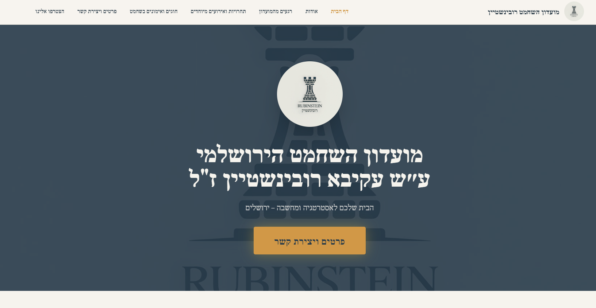
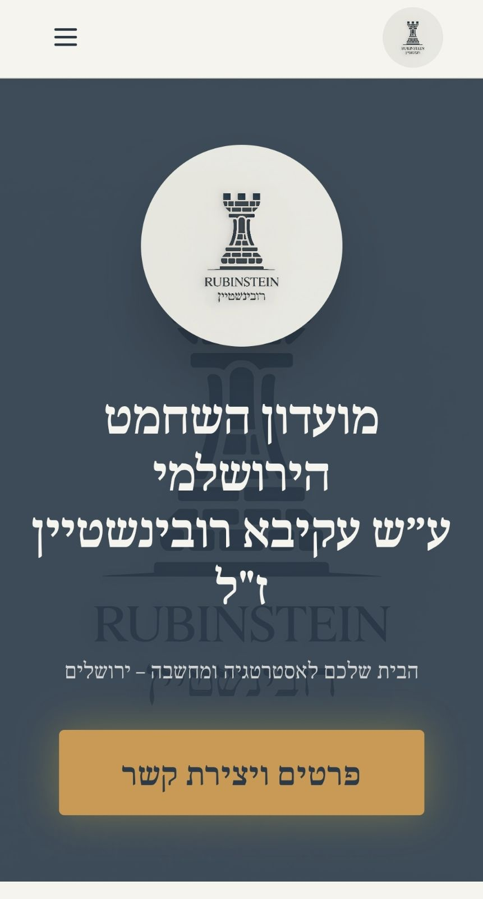

# Rubinstein Chess Club | Jerusalem

**A live, Hebrew-language website for the Rubinstein Chess Club in Jerusalem.** The website helps players, parents, and visitors explore the club's activities, discover chess classes and tournaments, and get in touch with the club.

**[Visit the live website](https://rubinstein-chess-jerusalem.org.il/)** · **[GitHub repository](https://github.com/efrat1824/rubinstein-chess-jerusalem)** 

## Project overview

This is a real-world, deployed front-end application built for a community chess club. It organizes information about the club in a responsive, right-to-left (RTL) experience, with multiple pages and navigation suitable for desktop and mobile devices.

## Main features

- **Multi-page navigation:** Home, About, Classes, Events, Gallery, Join Us, and Contact pages.
- **Hebrew and RTL layout:** Content and navigation are designed for Hebrew-speaking visitors.
- **Responsive interface:** Layouts and navigation adapt to smaller screens, including a mobile menu.
- **Chess club content:** Information about classes, activities, events, and the club community.
- **Photo gallery:** Images showcasing the club's activities.
- **Contact and registration information:** Ways for interested visitors to reach the club and learn about joining.
## Screenshots

### Desktop



### Mobile




## Tech stack

| Area | Technologies |
| --- | --- |
| Front end | React, TypeScript |
| Build and development | Vite |
| Styling | Tailwind CSS |
| UI | shadcn/ui, Radix UI, Lucide React |
| Routing | React Router |
| Deployment | Vercel |
| Version control | Git, GitHub |
| Test tooling | Vitest, React Testing Library |

## Run locally

Prerequisites: Node.js and npm installed.

```bash
git clone https://github.com/efrat1824/rubinstein-chess-jerusalem.git
cd rubinstein-chess-jerusalem
npm ci
npm run dev
```

Open **http://localhost:8080/** in your browser. The development server port is configured in `vite.config.ts`.

### Available commands

| Command | Purpose |
| --- | --- |
| `npm run dev` | Start the development server |
| `npm run build` | Create a production build |
| `npm run preview` | Preview the production build locally |
| `npm run lint` | Run ESLint |
| `npm run test` | Run the Vitest test suite once |
| `npm run test:watch` | Run Vitest in watch mode |

## Project structure

```text
src/
  pages/          # Main route components
  components/     # Navigation, footer, and reusable UI
  assets/         # Site images and media
  hooks/          # Custom React hooks
  lib/            # Shared utilities
  test/           # Vitest setup and example test
public/           # Static assets
vite.config.ts     # Vite configuration and local server port
vitest.config.ts   # Test configuration
vercel.json        # SPA routing configuration for deployment
```

## Testing and deployment

The project uses Vitest and React Testing Library for automated testing. Tests currently verify navigation links and mobile menu open/close behavior. Additional functionality is not yet covered by automated tests.

The application is deployed on **Vercel**. The `vercel.json` configuration provides a rewrite to support client-side routes in the React single-page application.

## Development and maintenance

After the initial prototype, I continued developing, customizing, and maintaining the website in **Visual Studio Code**, tracking changes with **Git and GitHub**, and managing the production deployment through **Vercel**.

## Maintainer

**Efrat Katz** · [GitHub](https://github.com/efrat1824)


